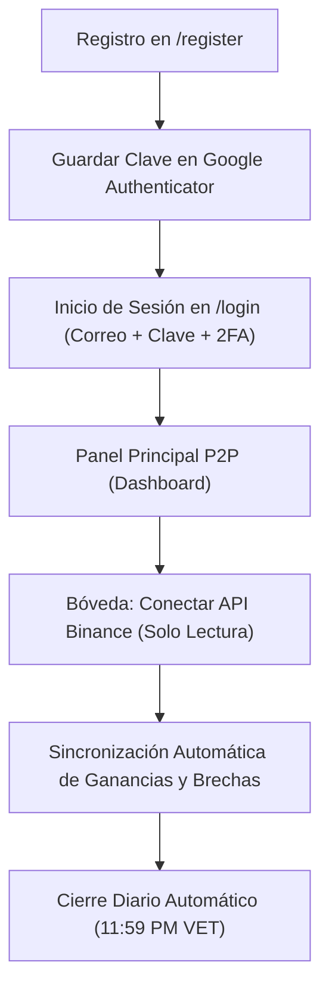

# 🇻🇪 Bot P2P Venezuela — Sistema Contable, Fiscal y Monitoreo de Brechas (USDT / VES)

> **Suite profesional de contabilidad, cálculo fiscal (SENIAT 16%) y monitoreo de liquidez bancaria en vivo para comerciantes (*merchants* / cajeros) de Binance P2P en Venezuela.**

[](https://nextjs.org/)
[](https://www.typescriptlang.org/)
[](https://tailwindcss.com/)
[](https://supabase.com/)
[](https://csrc.nist.gov/)

---

## 📌 ¿Qué es Bot P2P Venezuela?

**Bot P2P Venezuela** es una plataforma diseñada para que los operadores de cambio P2P de USDT/VES lleven el control exacto de sus operaciones diarias, protejan su margen real y cumplan con la normativa fiscal venezolana sin pagar impuestos indebidos sobre su capital de trabajo.

El sistema resuelve los 4 desafíos críticos del comercio P2P en Venezuela:

1. **Descuento Automático de Comisión Binance Maker (0.163%)**:
   - A cada anuncio publicado por el comerciante (sea de **Compra** o de **Venta**), el sistema descuenta la tasa oficial de **0.163%** (`amountUsdt * 0.00163`), asegurando que la ganancia visualizada sea 100% neta y real.
2. **Cumplimiento Tributario SENIAT (Norma BA VEN-NIF)**:
   - En Venezuela, el capital rotado en compra de criptoactivos está **exento de IVA** (costo de adquisición). La provisión fiscal del **16%** se aplica estricta y exclusivamente sobre el **margen bruto comercial**, evitando tributar sobre el dinero propio.
3. **Monitoreo de Brechas Bancarias en Vivo (7 Bancos Nacionales)**:
   - Conexión directa a la API de Binance C2C para consultar en tiempo real el precio del 2do anuncio de compra y el 2do anuncio de venta para:
     - 🟢 **Banesco**
     - 🟣 **Pago Móvil**
     - 🔵 **Mercantil**
     - 🔷 **BBVA Provincial**
     - 🔴 **Banco de Venezuela (BDV)**
     - 🟡 **Bancamiga**
     - ⚪ **Banco Nacional de Crédito (BNC)**
4. **Seguridad Bancaria de Grado Militar (Zero-Trust)**:
   - Tu clave secreta de Binance jamás se expone. Se cifra en el servidor con **AES-256-GCM** y solo requiere permisos de **Solo Lectura** (*Read-Only*). El bot tiene bloqueado el retiro de fondos y el trading.
   - Acceso blindado con **Google Authenticator (2FA)** de 6 dígitos y sesiones firmadas con cookies `HttpOnly`.

---

## 🚀 Inicio Rápido: Instalación y Puesta en Marcha

### Requisitos Previos
* **Node.js**: Versión 18.18 o superior (recomendado Node.js 20 o 22 LTS).
* **NPM**, **PNPM** o **Yarn**.
* Una cuenta en [Binance](https://www.binance.com) (para generar la API Key de Solo Lectura).
* Una cuenta gratuita en [Supabase](https://supabase.com) (opcional si usas la base de datos local preconfigurada).

---

### Paso 1: Clonar el Repositorio
```bash
git clone https://github.com/tu-usuario/bot-p2p-venezuela.git
cd bot-p2p-venezuela
```

### Paso 2: Instalar Dependencias
```bash
npm install
```

### Paso 3: Configurar Variables de Entorno
Copia el archivo de ejemplo `.env.example` y crea tu archivo `.env`:

```bash
cp .env.example .env
```

Verifica o actualiza los siguientes valores en tu `.env`:
```env
# 1. Base de Datos Supabase (PostgreSQL)
NEXT_PUBLIC_SUPABASE_URL="https://tu-proyecto.supabase.co"
NEXT_PUBLIC_SUPABASE_ANON_KEY="tu-anon-key-de-supabase"

# 2. Seguridad de Sesiones y Cifrado
BETTER_AUTH_SECRET="tu-clave-secreta-aleatoria-de-64-caracteres"
MASTER_ENCRYPTION_KEY="tu-clave-hexadecimal-aes-256-de-64-caracteres"

# 3. Entorno Contable
SENIAT_TAX_RATE="0.16"
TIMEZONE="America/Caracas"
```

### Paso 4: Levantar el Proyecto en Desarrollo
```bash
npm run dev
```

Abre tu navegador en:
👉 En producción (Vercel): **[https://bot-p2-p.vercel.app](https://bot-p2-p.vercel.app)**
👉 En entorno local: **[http://localhost:3000](http://localhost:3000)**

---

## 📖 Flujo de Uso del Comerciante



### 1. Registro de Operador (`/register`)
- Ingresa tu Nombre o Razón Comercial, Correo Electrónico y Contraseña.
- Al registrarte, el sistema genera automáticamente tu **Clave Secreta de Google Authenticator**.
- Cópiala y agrégala en la app de tu teléfono móvil (*Google Authenticator*).

### 2. Inicio de Sesión Seguro (`/login`)
- Introduce tu correo, contraseña y el código de 6 dígitos generado en tiempo real por tu teléfono.

### 3. Conexión de Binance (Solo Lectura)
- Ve a la pestaña **Seguridad y Bóveda**.
- Pega tu **API Key** y tu **Secret Key** generadas en Binance (con permiso único de *Lectura*).
- Presiona **"Guardar Nuevas Claves"** y luego **"Probar Conexión"**.

### 4. Modo Contador Público (Auditoría SENIAT)
- En la barra superior, haz clic en **"Modo Contador"**.
- Ingresa tu contraseña de operador para desbloquear la vista fiscal.
- El contador puede auditar las ventas, revisar el cálculo del 16% de IVA sobre el margen y descargar el libro contable en **Excel / CSV** sin tener acceso a tus claves API ni a herramientas operativas.

---

## 🧮 Fórmula Financiera y Fiscal Aplicada

### 1. Anuncio de Compra (BUY - Maker)
$$\text{Comisión Binance (USDT)} = \text{Monto USDT} \times 0.00163$$
$$\text{USDT Netos Recibidos} = \text{Monto USDT} - \text{Comisión Binance}$$
$$\text{Costo Base Unitario (Bs.)} = \frac{\text{Total Pagado en Bs.}}{\text{USDT Netos Recibidos}}$$

### 2. Anuncio de Venta (SELL - Maker)
$$\text{Comisión Binance (USDT)} = \text{Monto USDT} \times 0.00163$$
$$\text{Comisión Binance en Bs.} = \text{Comisión Binance (USDT)} \times \text{Tasa de Venta}$$
$$\text{Capital Exento Recuperado (Bs.)} = \text{Monto USDT} \times \text{Costo Base Unitario}$$
$$\text{Utilidad Bruta Comercial (Bs.)} = (\text{Total Recibido en Bs.} - \text{Capital Exento}) - \text{Comisión Binance en Bs.}$$
$$\text{Provisión IVA SENIAT 16\% (Bs.)} = \text{Utilidad Bruta (Bs.)} \times 0.16$$
$$\text{Ganancia Libre Neta (Bs.)} = \text{Utilidad Bruta (Bs.)} - \text{Provisión IVA (Bs.)}$$

*Todos los cálculos numéricos se procesan con `Decimal.js` a 28 dígitos de precisión (sin errores de punto flotante).*

---

## 📂 Estructura del Código

```text
├── docs/                        # Documentación y guías para clientes
│   ├── Guia_Paso_a_Paso_Bot_P2P.pdf # Guía visual en PDF para usuarios finales
│   └── pantalla_binance.jpg    # Capturas de pantalla de referencia
├── src/
│   ├── app/                    # Next.js App Router (/login, /register, /, /api)
│   ├── features/
│   │   └── p2p-ledger/
│   │       ├── api/            # Hooks de React Query (Sincronización en vivo)
│   │       ├── components/     # Componentes UI (Bóveda, Brechas, Modo Contador)
│   │       ├── schemas/        # Validaciones de formularios Zod
│   │       └── store/          # Estado global con Zustand
│   ├── lib/                    # Cliente Supabase y utilidades
│   └── server/
│       ├── db/                 # Repositorio de base de datos Supabase / Vault
│       ├── hono/               # Endpoints API tipados con Hono
│       ├── security/           # Cifrado AES-256-GCM, Hash scrypt, TOTP 2FA
│       └── services/           # Lógica contable P2P y conexión Binance C2C
├── supabase/
│   └── schema.sql              # Estructura SQL relacional para Supabase
├── .env.example                # Plantilla de variables de entorno
└── package.json                # Dependencias del proyecto
```

---

## 🔒 Privacidad y Cumplimiento

* **Sin datos bancarios en la interfaz**: No se almacenan ni muestran números de cuenta bancaria personales.
* **Cierre Criptográfico Diario**: Todos los días a las **23:59:00 VET**, el sistema sella un acta inmutable con un hash **SHA-256**, impidiendo la alteración retroactiva de los libros contables.

---

## 📄 Licencia

Este software es de **uso privado y comercial bajo modelo SaaS**. Todos los derechos reservados.